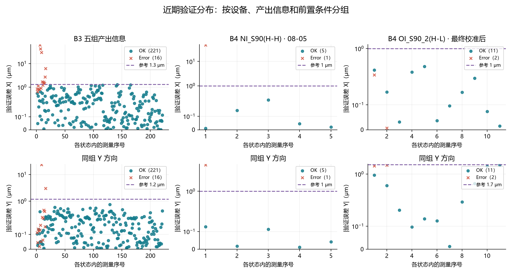
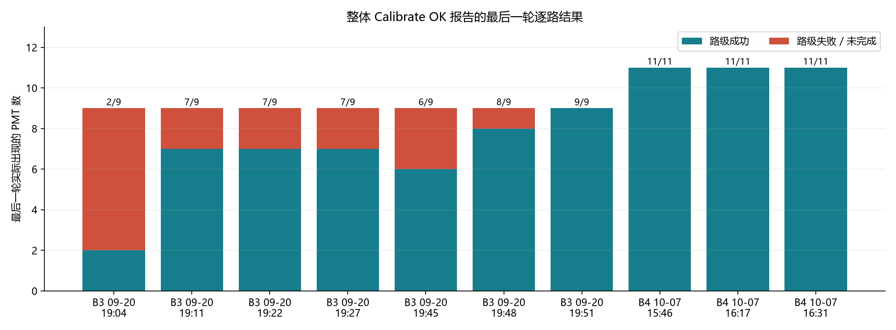
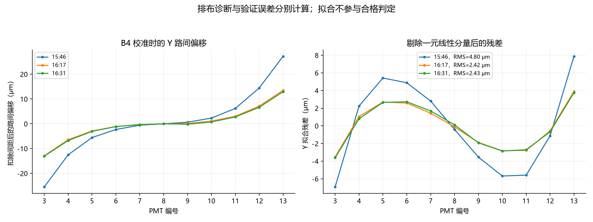

# CIB-LineCentricity 校准方案验收

验收日期：2026-10-13

## 统计口径

本次核对 B3、B4 已归档的 **401 份报告**，日期跨度为 2026-02-07 至 2026-10-07，其中含 B4 在 10-07 当天的 11 份，为本地归档全量。

- 其中 15 份为内容完全相同的副本。报告数仍按来源逐份统计；测量分布将设备、对象、通道、时间、版本和数值均相同的重复事件合并为一次。

| 设备 | 报告总数 | 整段 Calibrate：OK / Failed | Verify：OK / Failed | 步骤报告：Failed / Cancel |
| --- | ---: | ---: | ---: | ---: |
| B3 | 241 | 67 / 62 | 45 / 32 | 10 / 25 |
| B4 | 160 | 43 / 35 | 28 / 28 | 23 / 3 |

报告可能累计多轮尝试：报告数、测量事件数和图中通道数均不等于独立整机运行次数。

正文可识别版本 375 份，其中 **2.5.3.603 为 226 份**；26 份无版本字段。按版本变更记录，PMT 间距验证修复之前的记录只用于历史分析；当前行为的数值依据来自 2.5.3.603，近期范围为 2026-08-02 至 10-07。同号版本未记录精确的构建提交号，其适用性结合日志中的流程、参数与当前源码核对。

| 数值范围 | 完整逐路验证误差数 | OK / Error | 用途 |
| --- | ---: | ---: | --- |
| 全历史 | 847 | 715 / 132 | 判据复现与历史边界 |
| 2.5.3.603 | 534 | 453 / 81 | 当前行为核对，继续按日期和条件分组 |
| 近期 B3 | 237 | 221 / 16 | 五组产出信息的执行参考 |
| 近期 B4：NI_S90(H-H)，08-05 | 6 | 5 / 1 | 原有对象的执行参考 |
| 近期 B4：OI_S90_2(H-L)，10-07 | 58 | 19 / 39 | 按 Y 像素尺寸、校准轮次和阈值分层分析 |

误差与状态口径：

- 误差采用实际参与判定的逐路验证偏移，单位 μm；保存中心之差、校准时的路间偏移和拟合残差分别处理。
- OK 与 Error 保留测量当次的状态，最终 OK 报告中的先前失败同样保留。
- 847 个完整数值全部能按当次严格阈值复现判定；这是对日志保留精度的复核，不是测量不确定度评定。
- 匹配失败而未产生验证偏移的事件单独记录：不补零，不进入数值分布。

另核对 B4 同日 4 份 Y 像素尺寸校准及验证报告，作为前置依赖证据；不计入上述 401 份报告与 847 个测量。

130 份报告含拟合图，其中 Calibrate 120 份、Verify 10 份。拟合图按实际生成时间对应到测量轮次；拟合只作排布诊断。

## 失败分析

失败原因包括匹配、前置配置、采图及数值超差，各类的处理方式不同。报告状态由校准框架按最终结果统一生成，文件名只区分 OK、Failed、Cancel，具体原因仅见于正文。

报告级状态分布：整段 Calibrate 中 97/207 Failed（47%），Verify 中 60/133 Failed（45%）；步骤报告只有 Failed（33 份）与 Cancel（28 份）两种状态。合计 Failed 190 份。上述比例按报告计数、包含重试效应，不代表独立运行的失败率。

当前版本 90 份最终 Failed 报告的正文证据命中如下。类别互不排斥，同一报告可包含先前尝试或取消的内容，各类数量不能相加作为失败总数或发生率。

| 正文证据类别 | 报告数 | 处理与解释 |
| --- | ---: | --- |
| 模板匹配失败 | 34 | 查实际得分、模板、图像与通道；不以小位置误差代替匹配通过 |
| 暗场模板创建返回失败 | 19 | 先处理模板生成前置，再重做后续步骤 |
| 镜头不一致 | 12 | 核对选择镜头与当前镜头 |
| 对位失败 | 8 | 包括重试耗尽及指定位置匹配失败，查对位记录 |
| 采图链路异常 | 4 | 包括任务等待失败、扫描起点失败 |
| X 像素尺寸前置无效 | 1 | 先恢复同对象的有效像素尺寸结果 |
| 含数值验证超差 | 26 | 按设备、通道、Y 换算比例与当次阈值分析 |
| 含取消文本 | 30 | 与上列可重叠，不能全部解释为物理测量失败 |

B4 在 10-07 的 6 份 Verify Failed 中，前三份为 11 路全部 Y 超差；后续几份包含两端超差，以及 PMT 13 匹配得分 0.7956 低于 0.8 的事件。该匹配失败没有产生正式的验证偏移，未纳入上述 58 个数值。

## 优点

1. **主要流程有逐路运行证据，验收保留了失败边界。**

   - B3：09-20 19:51 的最后一轮校准覆盖 PMT 4～12 共 9 路且全部成功，19:53 验证 9 路通过；09-21 另有 OI_S90(H-H)、NI_S90(H-L) 验证 OK。
   - B4：08-05 的 NI_S90(H-H) 有 5 路通过。10-07 的 OI_S90_2(H-L)：三份 Calibrate OK 的最后一轮均覆盖 PMT 3～13 共 11 路且全部匹配成功；16:32～16:34 验证 PMT 4～12（主 PMT 8 误差 (0.399, −0.132) μm），16:35 补测 PMT 3、13 通过。两次验证同引 16:31 的校准中心，构成 11 路分批复测证据。
   - 上述路数均为当日该产率下全部启用的 PMT，未列入的路未启用，不构成漏测（启用集合随产率与日期变化）；单份 Verify OK 只能证明当次选中的路。

2. **当前数值判据执行一致。**

   对全部 847 个完整误差，按“|X| < X 阈值且 |Y| < Y 阈值”均可复现日志判定。

   - B3 近期 221 个 OK：|X| 中位数 0.182 μm，95% 分位数 0.932 μm，最大 1.277 μm；|Y| 最大 0.747 μm。
   - B4 NI_S90(H-H) 的 5 个 OK：|X|、|Y| 最大分别为 0.264、0.126 μm。
   - B4 新对象最终沿用同一套校准结果，按各路最后一次复测取值：11 路 |X| 最大 0.399 μm，|Y| 最大 1.660 μm。

3. **执行参考按设备、对象与前置条件区分。**

   执行参考采用实际生产配方，核对正常覆盖与失败重叠两类情况；判定数值均为严格小于，且要求逐路匹配成功、实际使用通道完整、主 PMT 有有效的校准和验证结果。

   | 设备与产出信息 | X / Y 执行参考 | 日志支持及适用条件 |
   | --- | --- | --- |
   | B3：OI_S90(H-H)、NI_S90(H-H)、NI_S90(H-L)、OI_S90_2(M-L)、NI_S90_2(M-L) | (1.3, 1.2) μm | 沿用五组最新配置，覆盖近期 221 个 OK；当次较紧阈值下的 7 个 Error 也落入此范围 |
   | B4：NI_S90(H-H) | (1, 1) μm | 沿用 08-05 配置，覆盖 5 个 OK，并拒绝 (47.048, 6.718) μm 的失败事件 |
   | B4：OI_S90_2(H-L) | (1, 1.7) μm | 当前配方执行参考，限于 10-07 16:14 后约 0.1055 μm/px 的 Y 像素尺寸及随后重做的线同心度校准；最终 11 路分批通过，其中 9 路使用更紧的 (1, 1)，两端 2 路使用 (1, 1.7) |

   B4 新对象的参考取自最终校准后的 13 个事件（11 OK、2 Error，含两端补测前的失败）；较早、同一 Y 比例阶段的 12 个事件仅用于补充异常边界；前段约 0.211 μm/px 时的 33 个 Error 仅作原因追溯，不混入正常分布。该对象仅覆盖一个下午，推荐值的适用范围有限；本次未修改设备配置。

   参考值边界：(1, 1.7) 的 Y 阈值由 1.0 放宽而来，两端补测值（−1.536、1.660 μm）与原失败幅度几乎相同；B3 最大正常 |X| 距 1.3 μm 仅 0.023 μm。参考值与部分历史 Error 不完全分离。若正常值持续贴近阈值、失败值落入参考范围或前置条件变更，应重新评估对应组。

## 缺点及改进

1. **整体校准 OK 仍会掩盖失败路，其中甚至包括主 PMT 失败。**

   - 2.5.3.603 的 65 份 Calibrate OK 中，最后一轮仍有 **20 份含失败路**，均为 B3，其中 2 份主 PMT 8 失败。
   - B3 09-20 19:04 的报告最后一轮仅 PMT 5、8 成功，其余 7 路失败；当天 7 份整体 OK 的前 6 份均未全路成功，直到 19:51 才达到 9/9。
   - B4 10-07 的三份整体 OK 最后一轮均为 11/11，但不能据此消除 B3 已发生的问题。

   验收与使用时应逐路核对最后一轮状态、实际使用通道和主 PMT，并保留失败路的编号与数量。校准按当日启用的 PMT 全集执行，失败路必为该产率实际使用的路，不能以“该路未启用”解释失败。

2. **拟合诊断须按轮次和点状态重算；排布存在非线性分量。**

   报告自带的校准拟合图按实际 PMT 间距绘制各路校准中心并做直线拟合。直接采用图上拟合结果的风险：

   - 拟合混入无效点：失败路以默认坐标参与计算，数值可为零或很大；已成功路的历史偏移也有超过 100 μm 的值，不能用固定幅度界限筛选。46 份图含此类无效点；3 份主路失败的图须整体排除。
   - 图与轮次错位：13 份报告的最后一张图属于更早已完成的轮次，其后的轮次已中断，不能用报告最后一轮的状态去解释这张图。
   - 重算口径：仅在主路与该路均成功、且至少 3 点可拟合的轴上重算；据此发现 81 个轴与日志自带的拟合角相差超过 1°。

   剔除无效点后，排布本身仍非直线：

   - B3 近期 22 份各路均有效的校准图：X 拟合角中位数 −0.306°，R² 中位数 0.990，残差 RMS 中位数 0.319 μm；Y 残差 RMS 中位数 1.475 μm。
   - B4 10-07 的三轮完整校准：Y 拟合角约 0.678°、0.340°、0.333°，RMS 分别为 4.800、2.417、2.426 μm；最终曲线呈现两端与中间不同的弯曲分量，单一拟合角不足以概括排布。

## 结论

**结论：通过。**

847 个完整验证误差均按当次严格阈值复现判定，B3、B4 当前版本均有最后一轮全路成功并验证通过的闭环证据。

Verify 判定阈值按分组沿用：B3 (1.3, 1.2)、B4 NI_S90(H-H) (1, 1)、B4 OI_S90_2(H-L) (1, 1.7) μm。