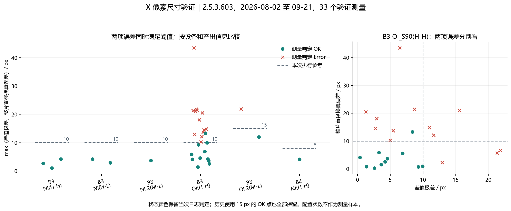
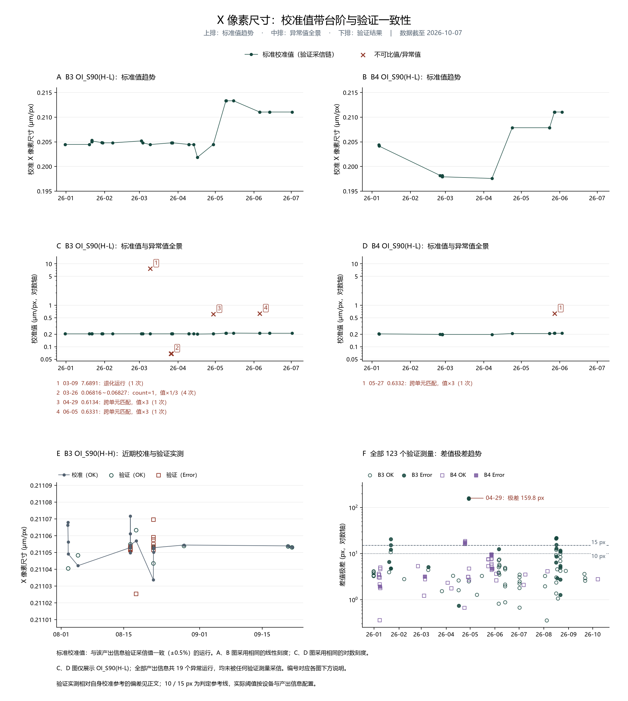

# CIB-XPixelSize X 像素尺寸校准方案验收

验收日期：2026-10-22

## 统计口径

### 数据范围与版本

- 核对 B3、B4 已归档报告 822 份（B3 531、B4 291），日期 2025-12-31～2026-10-07，覆盖已归档历史范围与新日期补充范围；其中 30 份为相同内容的重复副本，测量统计按去重后的独立运行计。
- 正文版本可识别 772 份、50 份未记录，其中 **2.5.3.603 为 201 份**。该版本号覆盖多次软件修改，结合数值公式、字段结构及 7 月下旬算法修复时间，以 **2026-08-02～10-07 的 2.5.3.603 测量**为当前判定参考的主要数据，较早数据用于历史配置与失败边界分析。

### 测量、运行与判定口径

- 验证测量按产出信息的一次完整验证数值结果计，保留当次事件状态；阈值配置快照及匹配中止、对位失败等无完整结果的报告不计样本。全历史 **123 个（OK 91、Error 32）**，其中当前参考数据 **34 个（B3 32、B4 2）**。
- 两项判据：相邻匹配点差值极差（下称差值极差）、整片直径换算像素数之差（下称整片误差）；123 个完整结果重算后均与日志验证像素尺寸及其判定一致。
- 校准运行取自 Calibrate OK 报告，395 个运行合并完全相同的重复记录后为 185 个唯一运行（同日多轮保留）；其中 166 个标准值构成判定参考；19 个异常值（跨单元匹配、单元数错位或退化）单独归类，验证测量的校准参考取自标准值。
- 日志最终状态统一记 OK/Failed，失败原因保留在日志文本中；最终 Failed 的归因先按前置与采图原因分类，再用数值阈值判断余下失败，像素尺寸超差以数值判据认定。当前版本最终 Failed 的原因命中数（非互斥）：

  | 原因 | 报告份数 |
  | --- | ---: |
  | 暗场模板创建返回 false（含用户取消，按前置异常计） | 35 |
  | 采图链路错误 | 14 |
  | 对位失败 | 3 |
  | 网络 I/O 异常 | 2 |

- 数值 Error 的成因可定位到采集环节：B3 04-29 同日一次 OK 的差值极差仅 2.49 px，两次 Error 达 156.3 / 159.8 px，三者使用同一值带的校准参考（校准值相对偏差约 1.4×10⁻⁵），极端极差来自匹配或采集异常。
- 历史 OK/Error 标签在不同判定阈值下产生，数值上互相交错；本次判定以按判据重算的结果为准：B3 OI_S90(H-L) 在 15/5/6/50 px 间多次切换、03-09 起稳定 10 px；B3 OI_S90(H-H) 在 10/15/11 px 间切换、08-28 起稳定 10 px；B4 自 04 月起以 8 px 为主。
- 边界样本（B3 OI_S90(H-H)，两项误差较大值）：历史 OK 中一项 13.308 px 在 15 px 下通过、10 px 参考会拒绝它；历史 Error 最低 10.294 px；10 px 下通过的边缘值 9.953 px，距门限约 0.047 px。阈值参考按当前稳定配置执行；边界样本显示，放宽至 15 px 会吸收部分历史失败测量。

## 优点

1. **主流程与验证具有近期运行证据。**
   - B3：2026-09-20～21 的 3 份 Calibrate OK、3 份 Verify OK，覆盖 OI_S90(H-H) 与 NI_S90(H-L)；B4：08-05 的 NI_S90(H-H) 校准与验证均 OK，10-07 的 OI_S90_2(H-L) 完成 Calibrate OK 后验证 OK。
   - 当前参考范围的 34 个验证测量含 20 个 OK、14 个 Error，可同时比较正常结果和数值失败结果。

2. **两项误差共同判定确有必要。**
   - 近期 Error 中整片误差最小仅 2.291 px；整片误差低于阈值不单独构成通过，两项误差需同时不超过阈值。123 个全历史完整结果均能按“极差 ≤ 阈值且整片误差 ≤ 阈值”复现日志判定，图中同时保留两项误差。

3. **按设备和产出信息沿用阈值有实测依据。**
   - 当前版本实际阈值：B3 为 10/11/15 px（11 px 仅见于 08-21 OI_S90(H-H) 的过渡配置），B4 为 8 px；软件内置默认 15 px，实际生效值由配方按产出信息配置。两个误差共用同一阈值，执行参考如下：

   | 设备与产出信息 | 执行参考 | 近期有效测量 | 支持情况 |
   | --- | ---: | ---: | --- |
   | B3 OI_S90(H-H) | 10 px | 11 OK、13 Error | 覆盖 10 个历史 OK，拦截 13 个 Error；另 1 个以 15 px 判 OK 的历史测量会被重新判为不通过 |
   | B3 NI_S90(H-H)、NI_S90(H-L)、NI_S90_2(M-L) | 10 px | 合计 6 OK | 两项误差的较大值最大 4.227 px；同期没有数值失败样本 |
   | B3 OI_S90_2(M-L) | 15 px | 1 OK、1 Error | 两项误差的较大值分别为 12.038、21.869 px；保持该产出信息已使用的 15 px |
   | B4 NI_S90(H-H) | 8 px | 1 OK | 差值极差 4.155 px、整片误差 3.129 px |
   | B4 OI_S90_2(H-L) | 8 px | 1 OK | 差值极差 2.780 px、整片误差 0.808 px（10-07）；与 B4 其他产出信息共用 8 px 参考 |

   - OI_S90(H-H) 采用 10 px 的主要依据为最近 08-28、09-20、09-21 三次 OK 结果及历史失败边界，这三次两项误差的较大值分别为 4.203、3.608、2.574 px。

   

4. **校准值时间序列稳定，跨月变化为可对账的值带台阶。**
   - 参考窗口内 B3 OI_S90(H-H)：18 个校准运行组成单一值带（0.211034～0.211072 μm/px，全距 0.018%）；24 个验证测量相对自身校准参考的偏差中位数 0.003%、最大 0.017%（08-21）。
   - 跨月校准值呈日期聚集的台阶而非连续漂移：

   | 设备与产出信息 | 值带演变（μm/px） |
   | --- | --- |
   | B3 OI_S90(H-L) | 0.20448（2025-12-31～2026-04-29）→ 0.21333（05-09～15，2.5.3.508/511）→ 0.21105（06-05～07-01，2.5.3.603） |
   | B4 OI_S90(H-L) | 0.20422（01-06）→ 0.19757～0.19820（02-24～04-07）→ 0.20787（04-23～05-23）→ 0.21106（05-27～06-02） |
   | B4 NI_S90(H-M) | 01-08 同日出现 0.22143 / 0.20536 / 0.20549 三个值带；03-04 起转为 0.13965 / 0.14003，前后断裂对应配方变更 |

   

## 缺点及改进

1. **部分对象样本少。**
   - B4 当前参考范围仅 2 个完整验证数值（08-05 NI_S90(H-H)、10-07 OI_S90_2(H-L)），且此前主力产出信息 OI_S90(H-L) 自 06-02 后无完整测量；B3 两个中倍率产出信息也仅 1～2 个。
   - 执行口径：保持分设备、分产出信息的参考值；没有近期数值证据的产出信息按其已有有效配方执行，获得测量后单独建立参考。

## 结论

**结论：通过。**

123 个完整验证测量均按两项判据复现日志判定，B3、B4 当前版本均有校准与验证均 OK 的近期闭环证据。