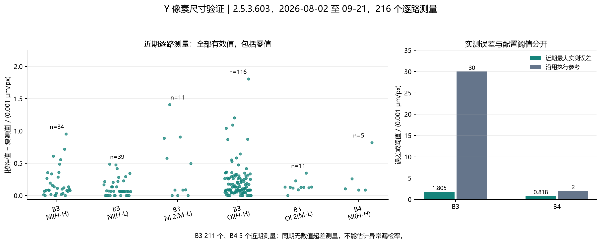

# CIB-YPixelSize Y 像素尺寸校准方案验收

验收日期：2026-10-23

## 统计口径

### 数据范围与版本

- 核对 B3、B4 归档的 Y 像素尺寸校准报告，合并四索引（extracted_lossless_v1 及 09-22 / 10-08 / 10-20 三批 log_refresh）按内容 sha256 去重后共 **394 份（B3 159、B4 235）**，日期 2026-02-07～10-10；其中 Calibrate 报告 286 份（成功 111、失败 146、取消 29），Verify 报告 108 份（成功 92、失败 16）。
- 测量级软件版本分布：**2.5.3.603 共 545 个测量**，2.5.3.511 共 138 个，2.5.2.413 共 47 个，2.2.0.1128 共 46 个，2.5.1.327 与 2.5.3.601 各 18 个，2.5.3.508 共 3 个。
- 与 X 项一致，以 **2026-08-02 起的 2.5.3.603 测量**为当前判定参考窗口，共 353 个逐路验证测量（B3 241、B4 112）；较早数据用于历史配置与失败边界分析。

### 测量、运行与判定口径

- 验证测量为 Verify 报告中逐 PMT 的「校准值—复测值—误差」三元组，全部索引去重后共 **815 个（B3 452、B4 363）**，均为日志判定 OK 的验证测量；全历史唯一的数值 Error 为 B4 2026-05-28（版本 2.5.3.511、OI_S10(L-L)、PMT 2）：校准 0.340909、复测 0.196078，误差 0.144831 μm/px，单独统计。
- 判定重算口径为 |校准值−复测值| = 误差且误差 < 阈值，与软件逐 PMT 判定（|error| < Threshold）一致；历史 OK/Error 标签在不同阈值配置下产生，本次判定以重算结果为准。参考窗口内误差中位数 0.0000944 μm/px、95% 分位 0.000646 μm/px、最大 0.001805 μm/px。
- 阈值为配方配置项，按设备和产出信息分别配置，推荐维持现有数值作为执行参考阈值，覆盖情况见优点 2：B3 五组产出沿用 2026-08-30 校准会话记录的 0.03 μm/px；B4 五组产出在参考窗口内均按 0.002 μm/px 执行（NI_S90(H-H) 沿用 2026-08-05 配置，其余组自 2026-07 起陆续使用同一数值）。配置演变：早期各产出使用 0.005/0.006/0.01/0.012/0.02/0.031/0.05/0.08 μm/px 等多种数值，之后收敛至上述数值。缺样本的组按最近一次运行的历史值执行并随运行复评。逐组全历史误差分布与执行参考如下（单位 μm/px；n 为全历史测量数，近期测量取参考窗口内的测量数；执行参考阈值列同值合并显示，空单元格取同组上方数值；近期 0 即缺样本，其阈值为该组最近一次运行的历史值）：

  | 设备 | 产出信息 | n | 中位数 | 95% 分位 | 最大 | 执行参考阈值 | 近期测量 |
  | --- | --- | ---: | ---: | ---: | ---: | ---: | ---: |
  | B3 | NI_S40(M-L) | 33 | 0.000000 | 0.000171 | 0.000341 | 0.03 | 0 |
  | B3 | NI_S90(H-H) | 34 | 0.0000959 | 0.000611 | 0.000954 | | 34 |
  | B3 | NI_S90(H-L) | 102 | 0.0000664 | 0.000469 | 0.000536 | | 69 |
  | B3 | NI_S90_2(M-L) | 11 | 0.0000882 | 0.00141 | 0.00141 | | 11 |
  | B3 | OI_S10(L-L) | 44 | 0.000869 | 0.00899 | 0.01584 | | 0 |
  | B3 | OI_S90(H-H) | 116 | 0.000116 | 0.000646 | 0.001805 | | 116 |
  | B3 | OI_S90(H-L) | 68 | 0.0000929 | 0.000301 | 0.000432 | | 0 |
  | B3 | OI_S90_2(M-L) | 11 | 0.000128 | 0.000349 | 0.000349 | | 11 |
  | B3 | OI_S40(M-L) | 33 | 0.000197 | 0.000406 | 0.000884 | 0.05 | 0 |
  | B4 | NI_S90(H-H) | 38 | 0.000126 | 0.000996 | 0.00112 | 0.002 | 38 |
  | B4 | NI_S90(H-L) | 41 | 0.0000679 | 0.000212 | 0.000271 | | 7 |
  | B4 | OI_S90(H-H) | 54 | 0.000148 | 0.000343 | 0.000671 | | 38 |
  | B4 | OI_S90(H-L) | 102 | 0.0000738 | 0.000208 | 0.000312 | | 7 |
  | B4 | OI_S90_2(H-L) | 22 | 0.0000190 | 0.000120 | 0.000148 | | 22 |
  | B4 | NI_S90(H-M) | 29 | 0.0000366 | 0.000114 | 0.000152 | 0.01 | 0 |
  | B4 | OI_S40(M-L) | 33 | 0.000207 | 0.000373 | 0.00158 | 0.012 | 0 |
  | B4 | NI_S40(M-L) | 25 | 0.000154 | 0.000369 | 0.000400 | 0.03 | 0 |
  | B4 | OI_S10(L-L) | 19 | 0.00184 | 0.00902 | 0.02179 | 0.031 | 0 |

  

- 2026-10-07 B4 OI_S90_2(H-L) 同日出现两套 Y 标尺值：15:24 校准值约 0.2109 μm/px、16:14 约 0.1055 μm/px，恰差两倍，各自 11 路测量全部通过 0.002 μm/px 自检（误差中位数 0.0000841 和 0.0000131）。经确认，成因为两次校准的 Y-CBE 加与不加，属可对账的口径差异。执行口径：参考值按运行变化复评，统一 Y-CBE 口径后复评；可疑对象结合投影图/峰标记复核，或增加跨周期一致性检查。

## 优点

1. **主流程与验证有近期闭环证据。**
   - 参考窗口（2.5.3.603、2026-08-02 起）内 353 个逐路验证测量全部 OK。
   - B3 在 2026-09-20～21 有校准 OK 3 份、验证 OK 5 份；B4 在 2026-08-05（NI_S90(H-H)）与 2026-10-07（OI_S90_2(H-L)）的校准与验证均 OK，构成完整闭环。

2. **推荐阈值有实测覆盖依据。**
   - B3 五组 0.03 μm/px 覆盖参考窗口内 B3 全部 241 个测量（最大 0.001805，约占阈值 6%）。
   - B4 五组 0.002 μm/px 覆盖参考窗口内 B4 全部 112 个测量（最大 0.00112，约占阈值 56%）。

3. **前置失败与数值失败可分离。**
   - 校准失败主要来自前置配置与对位环节（如镜头期望 5X/实际 50X 不一致、对位匹配得分 0）。
   - 数值判据的失败单独可辨；16 份 Verify 失败中 15 份无逐路数值结果（含对位失败 2 份，均为 B3 2026-08-18），属前置失败；B4 2026-05-28 一份含逐路数值，即全历史唯一数值 Error 的出处。

4. **校准值与复测值自洽。**
   - 815 个日志判定 OK 的验证测量全部满足 |校准值−复测值| = 误差且误差 < 阈值的重算判定，与软件逐 PMT 判定一致。
   - OI_S90_2(H-L) 组误差最小（最大 0.000148），说明峰距换算在单次运行内的复测一致性良好。

## 缺点及改进

1. **当前失败数值样本不足。**
   - 全历史仅一例数值 Error（B4 2026-05-28、OI_S10(L-L)、PMT 2、误差 0.144831）。
   - 执行口径：保持现阈值，积累失败样本后复评。

2. **B3 现阈值相对近期波动偏宽。**
   - 参考窗口内最大误差仅占 0.03 阈值的约 6%。
   - 执行口径：阈值维持 0.03 μm/px。

3. **部分产出信息缺近期样本。**
   - B4 参考窗口内仅 NI_S90(H-H)、OI_S90_2(H-L) 两组有完整闭环，NI_S40(M-L)、NI_S90(H-M)、OI_S10(L-L)、OI_S40(M-L) 四组无近期测量。
   - B3 也有四组无近期测量：NI_S40(M-L)、OI_S10(L-L)、OI_S40(M-L)、OI_S90(H-L)。
   - 执行口径：保持分设备分产出信息参考值，缺样本的组沿用最近一次运行的历史值并随运行复评。

## 结论

**结论：通过。**

815 个完整验证测量（B3 452、B4 363）均按 |校准值−复测值| = 误差且误差 < 阈值的判据复现日志判定。B3、B4 在当前版本（2.5.3.603）均有校准与验证双 OK 的近期闭环证据。